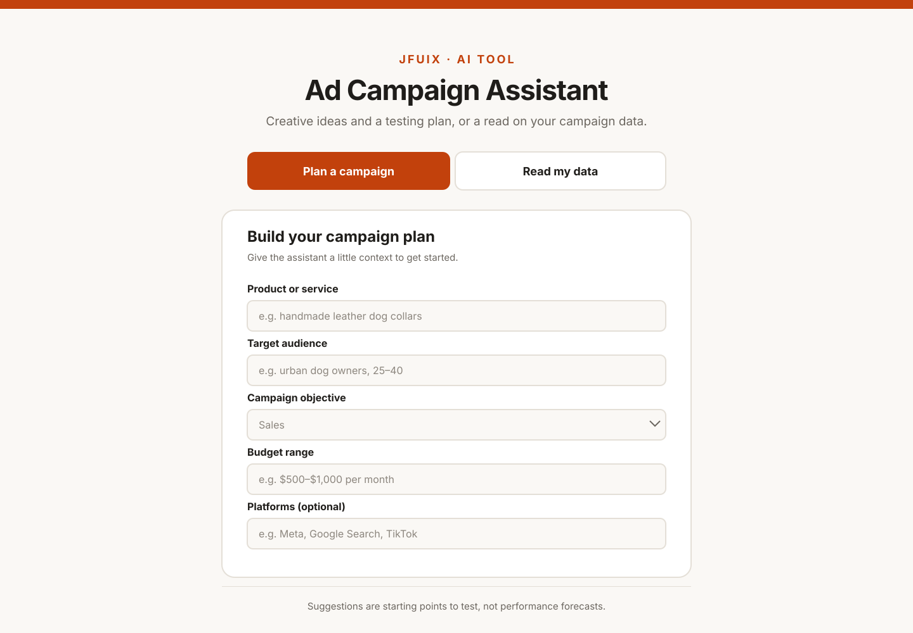
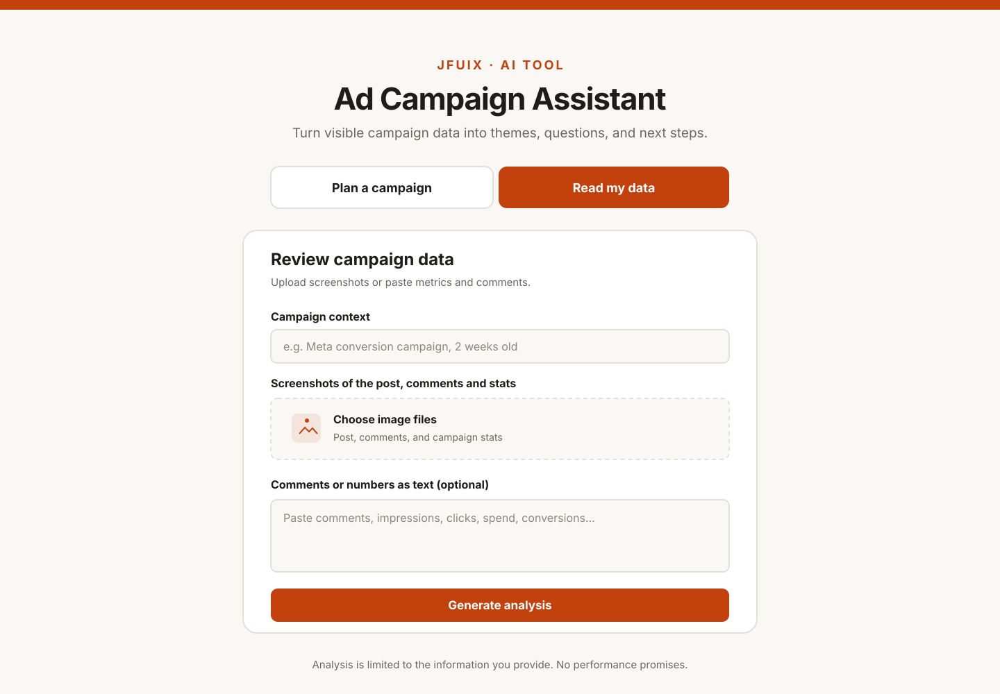

# Ad Campaign Assistant

A small tool for planning ad campaigns and reviewing campaign screenshots or performance notes.

The idea is to help organize the first round of thinking: generate creative angles, draft headline options, build a testing checklist, and summarize the information visible in campaign data. It is a starting point for analysis, not a promise of campaign results.

## About

**Ad Campaign Assistant** is a lightweight, AI-assisted workspace for developing advertising campaign ideas and making sense of campaign performance snapshots.

It brings two useful parts of the campaign workflow into one interface: a campaign planner that helps turn a business goal and audience brief into creative directions, and a campaign review tool that organizes information from screenshots or written performance notes into observations and potential next steps.

The project explores how AI can support marketers during early planning and analysis without replacing strategic judgment. It is designed to make campaign thinking more structured, surface questions worth investigating, and help teams prepare ideas to test.

**Project type:** AI-assisted digital marketing tool  
**Primary use cases:** Campaign planning, creative ideation, headline generation, ad testing preparation, and campaign snapshot analysis  
**Built with:** HTML, CSS, and JavaScript  
**Format:** Single-page web application

This is a prototype and decision-support tool. It does not connect to advertising platforms, retrieve live account data, or guarantee campaign outcomes. AI-generated recommendations should be reviewed and validated before use.

## What it does

### Plan a campaign
- Collects the product or service, target audience, objective, budget, and platforms.
- Suggests creative angles and headline variations.
- Outlines ad formats, landing-page considerations, and a testing checklist.

### Review campaign data
- Accepts screenshots and/or pasted campaign notes.
- Organizes visible numbers and comment themes.
- Calls out possible explanations, data gaps, and useful next steps.
- Avoids treating limited comments or incomplete screenshots as proof of broad public opinion.

## Screenshots

### Campaign Planner

### Campaign Data Review

## Built with

- HTML
- CSS
- JavaScript

The interface is contained in a single `index.html` file.

## Try it

**Repository:** [JFUIX/adcampaign-assistant](https://github.com/JFUIX/adcampaign-assistant)

GitHub Pages is enabled for this repository, but the generation flow depends on a Claude access integration provided by the hosting environment. Opening the static page on its own does not guarantee that AI generation will work for every visitor. The tool needs that integration to be available.

## Run locally

1. Clone or download this repository.
2. Open `index.html` in a browser.

The page layout can be viewed locally. AI generation will only work when the required Claude integration is available.

## Current limitations

- Suggestions are starting points to test, not performance forecasts.
- Campaign analysis is limited to the screenshots and text supplied.
- It does not connect directly to advertising accounts or fetch live campaign metrics.
- The AI generation feature depends on an external integration.

## Status

A small prototype exploring practical AI-assisted workflows for digital marketing.

Built by [JFUIX](https://github.com/JFUIX).
